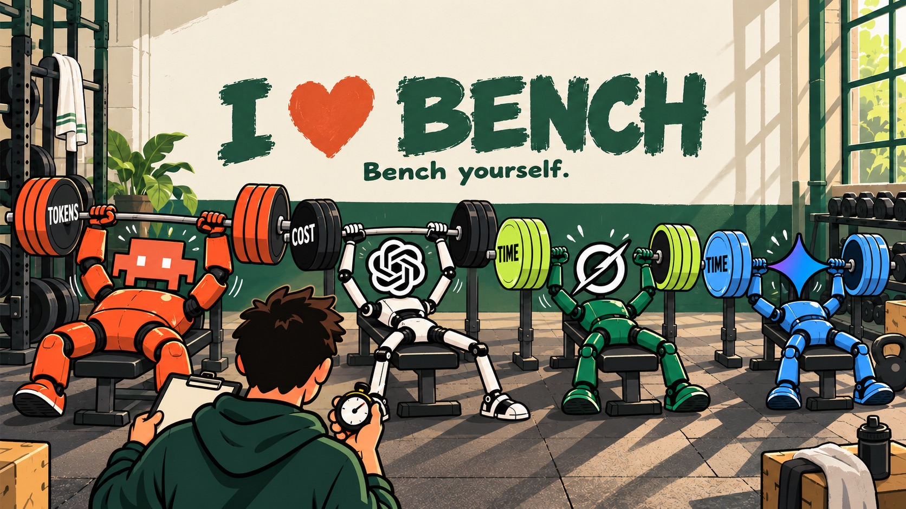
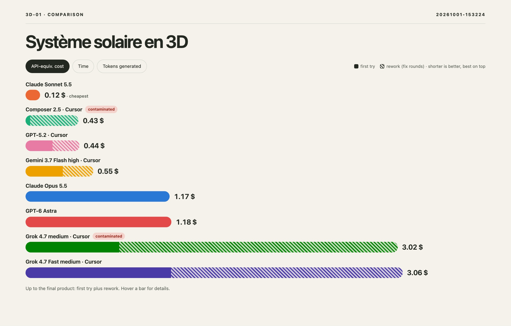
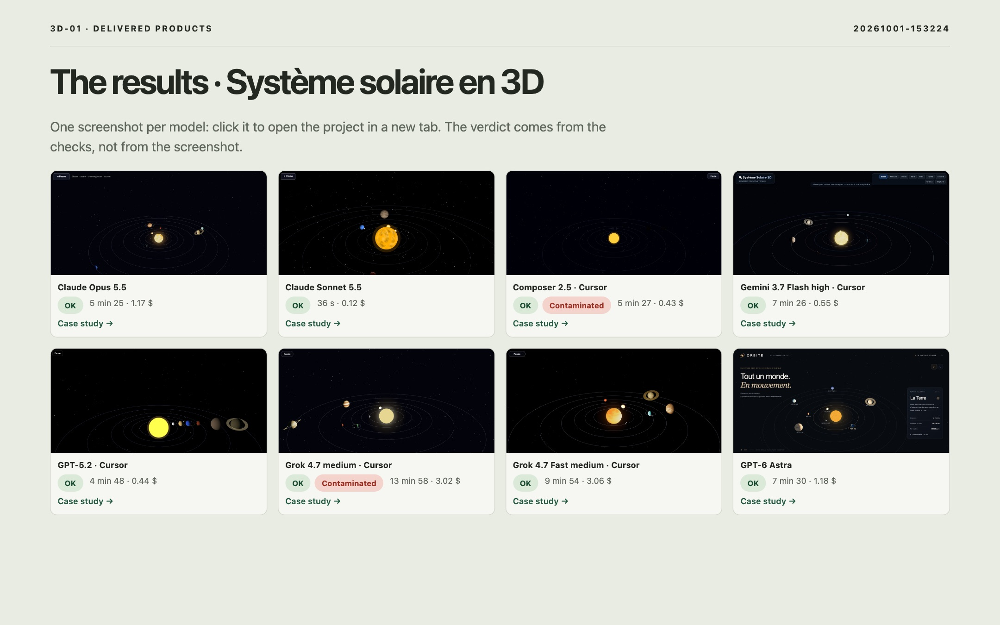

<div align="center">



# AiLoveBench

**Stop trusting AI companies' benchmarks. Do it yourself. Bench yourself.**

Run real production tasks on **your** coding agents, on **your** machine, with **your** subscriptions —
then test what they shipped, make them fix their own bugs, and see what it really cost.

[](./LICENSE)
[](https://nodejs.org)
[](#requirements)

</div>

---

## Why

Model leaderboards are run by the labs that sell the models, on tasks that aren't yours, with
settings you don't use. What you actually want to know is simpler:

> *On the kind of work I do, with the agents I pay for, which one ships something that works —
> how fast, and for how much?*

AiLoveBench answers that with **finished products**, not scores. Every agent gets the same brief,
builds a real project in its own sandbox, and is judged on whether the product works.

## What you get

- 🧪 **Real tasks, real products** — a landing page, a 3D scene, a buggy checkout to fix, a motion
  design video. The build must actually run; bugs only count when a script reproduces them twice.
- 🔁 **The cost of getting it right** — confirmed bugs go back to the same agent, in the same session,
  for up to 3 fix rounds. You see the first attempt, the rework, and the total to a working product.
- 💸 **Real cost, real time** — tokens read from each agent's own transcript, priced as an
  API-equivalent cost from a dated price table (not an invoice), plus agent time and the share of
  your subscription quota each run used.
- 🔒 **No peeking** — on macOS every agent runs in a sandbox that can't read the other agents' work
  nor the hidden tests. Transcripts are checked too: an agent that looked is flagged *contaminated*
  and left out of every comparison.
- 🧰 **Bare vs. your setup** — run agents *bare* (no personal instructions, skills, MCP, hooks) or
  *with your harness*, and see what your setup really buys you.
- 📊 **A report you can share** — web slides and a PDF: screenshots of every product, Apple-style
  comparison bars (cost · time · tokens), planted-bug scorecards, one slide per case.
  Every product stays served on its own port so you can click through and judge for yourself.

<sub>N tests, one machine, one date: an indication, not a ranking.</sub>

<p align="center">
  
  
</p>

## Quick start

```bash
npx ailovebench          # try it, nothing to install
```

or keep it around:

```bash
npm install -g ailovebench
ailovebench              # interactive: pick models, projects, modes — then watch the waves run
```

The wizard checks your quota before starting, runs one project at a time with all selected models
in parallel, then opens the report and keeps every product online until you press `Ctrl+C`.
On first use it downloads the headless browser used for QA (once).

### Requirements

| | |
|---|---|
| **OS** | macOS recommended (agent sandbox). Other systems run without the sandbox; transcripts are still checked. |
| **Node** | 20 or later |
| **herdr** | the terminal workspace manager for AI coding agents, used to drive each agent session. If it is missing, `ailovebench` offers to install it with the official script (`curl -fsSL https://herdr.dev/install.sh \| sh`, into `~/.local/bin`, no sudo) |
| **Agents** | any of [Claude Code](https://claude.com/claude-code), Codex CLI, Cursor CLI (`cursor-agent`) — installed and logged in |
| **ffmpeg** | only for the motion design task (video checks) |

AiLoveBench uses your existing subscriptions through the agents' own CLIs. It never asks for an API key.

## Usage

```bash
ailovebench                                   # wizard (new bench, add to a bench, recent, delete)
ailovebench detect                            # machine, installed agents, models, subscriptions
ailovebench project . --write                 # what this project cost, Claude + Codex (see below)

ailovebench bench --models claude-opus-5-5,gpt-6-astra,cursor:composer-2.5 --tasks all
ailovebench bench --models claude-sonnet-5-5 --tasks fix-01 --into <run-id>   # add jobs to a run
ailovebench bench ... --modes bare,harness    # compare bare agents with your own setup
ailovebench bench ... --tester auto           # add a black-box tester from another provider

ailovebench serve <run-folder>                # report + every product on its own port
ailovebench report <run-folder>               # rebuild the HTML + PDF report
ailovebench delete <run-id>
```

Runs live in `~/.ailovebench/runs/<run-id>/`: each job keeps its sandbox, transcript, QA evidence
and `job.json`. The interface (CLI, wizard and report) follows your system language — French or
English (`AILOVEBENCH_LANG=en` to force).

## Project cost

How much did a real project cost in tokens, from the first prompt to delivery, **Claude and Codex
together**? `ailovebench project` finds every Claude Code and Codex session started in a folder or
one of its subfolders — desktop apps (Claude Desktop in Claude Code mode, the ChatGPT app in Codex
mode), terminal, `codex exec`, subagents — and adds them up.

```bash
npx ailovebench project .                        # this folder: tokens, API-equivalent cost, by tool and by model
npx ailovebench project . --write                # also writes docs/couts.md (a Markdown report)
npx ailovebench project ~/sites/acme --since 2026-10-01 --until 2026-10-31 --json
```

It reads the transcripts on your machine (`~/.claude`, `~/.codex`, or `CLAUDE_CONFIG_DIR` /
`CODEX_HOME`), never changes them, needs no terminal UI and exits with code 0: your agent can run it
itself. Only numbers and model names are printed — never your prompts.

Paste this into your project's `CLAUDE.md` / `AGENTS.md` so the agent keeps the count:

> Project cost: when I ask for "the cost report", or at the end of each major step (PRD, mockup,
> site generation, delivery), run `npx ailovebench project . --write docs/couts.md`, then give me
> the total and the Claude / Codex split.

French version, an optional Claude Code hook and how sessions are matched: [`docs/project-cost.md`](docs/project-cost.md).

## The tasks

| Task | What the agent must deliver | How it is checked |
|---|---|---|
| `web-01` | A product landing page (Lumio) | build, console, no external requests, responsive, Lighthouse, pricing & keyboard FAQ scenarios |
| `3d-01` | An interactive Three.js solar system | WebGL canvas, animation, frame rate, drag / zoom interaction |
| `fix-01` | Repair a checkout page shipped with 12 planted bugs | provided + hidden tests, UI scenarios, contrast, focus — each planted bug detected on the original, then re-checked |
| `motion-01` | A 10-second launch video (MP4) and the page that plays it | codec, resolution, duration, fps, no black or frozen frames, contact sheet |
| `slides-01` | A 10-slide investor pitch deck (HTML, 16:9) | one slide at a time, keyboard navigation, slide counter, no text overflowing or clipped at 1280×720 and 1920×1080, minimum font size, exact figures, SVG/canvas chart, comparison table, Lighthouse (desktop) |

Have an idea of your own? Pick **"Bench my idea instead"** in the wizard: describe it, and it
becomes a task run on every selected model. Task prompts are currently written in French.

## How it works

```
for each project, all models in parallel, each in its own sandbox:

  brief ─▶ agent builds ─▶ QA ─────────────────────────▶ report
                           │  automatic checks           │  screenshots · bars · bugs
                           │  (+ black-box tester)       │  cost · time · quota
                           └─▶ confirmed bugs ─▶ same agent fixes (≤ 3 rounds) ─┘
```

- **Same start for everyone** — same prompt, same autonomy rules, same reasoning effort, a fresh
  folder per job.
- **Measured, not estimated** — tokens come from each agent's transcript (Claude Code, Codex rollouts,
  Cursor stream), split between the first attempt and the fix rounds.
- **Honest numbers** — a model missing from the price table is "not priced", never "0 $"; unknown
  usage stays unknown.

More in [`docs/how-it-works.md`](docs/how-it-works.md), and the rules every report must follow in
[`docs/REPORT_RULES.md`](docs/REPORT_RULES.md).

## Roadmap

- Bench a real project while you build it: quality over time (its cost: `ailovebench project`)
- More tasks (API, game), task prompts in English
- Agent sandbox on Linux

## Contributing

Issues and pull requests are welcome. To work on the code:

```bash
git clone https://github.com/Dupflo/ailovebench.git && cd ailovebench
npm install && npm run build && npm link   # `ailovebench` now runs your local build
npm test
```

A task is a folder in `catalog/`: `task.yaml` (checks, deliverable, budget), `prompt.md` (the
brief) and `hidden/` (scenarios and tests the agent never sees) — see
[`docs/how-it-works.md`](docs/how-it-works.md#adding-a-task).

## License

[MIT](./LICENSE) © Florian Dupuis
